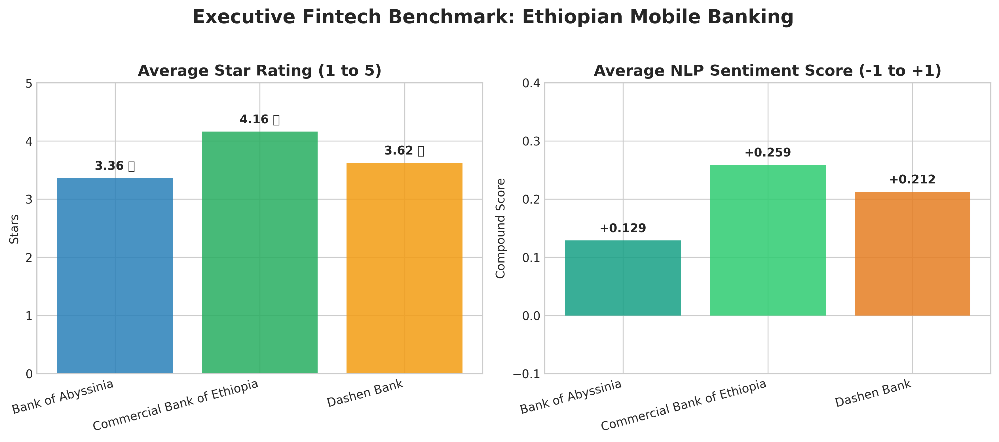
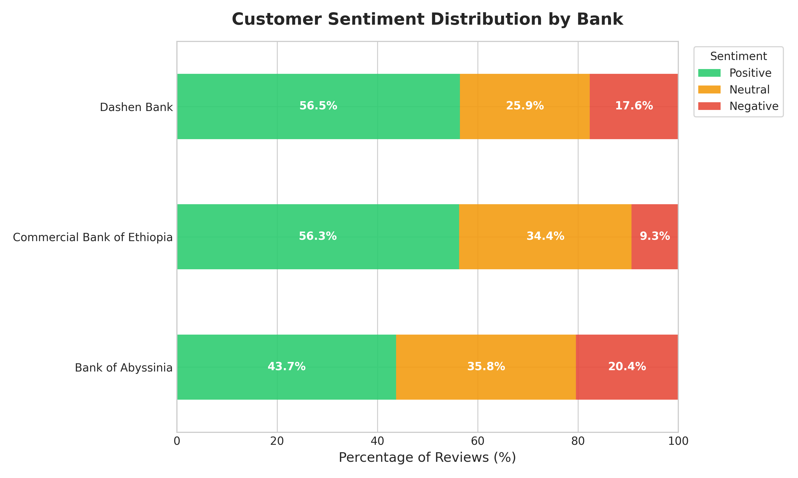
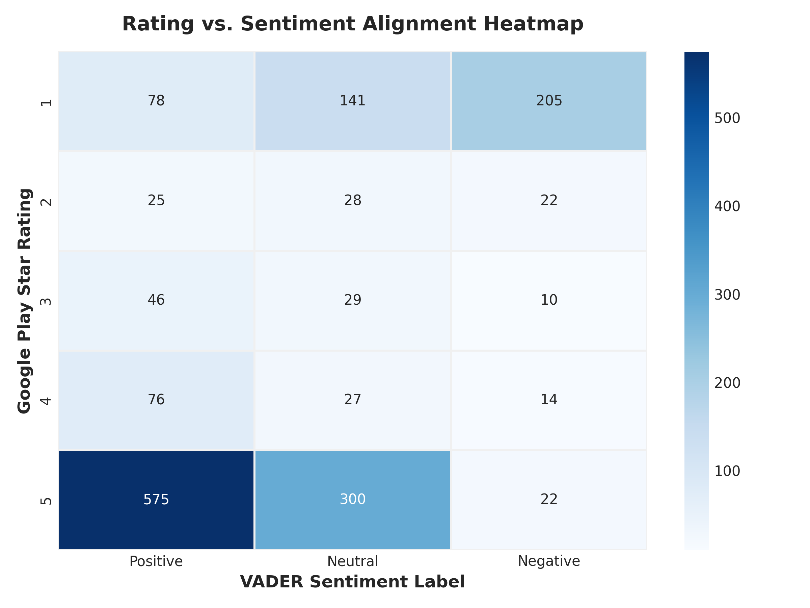
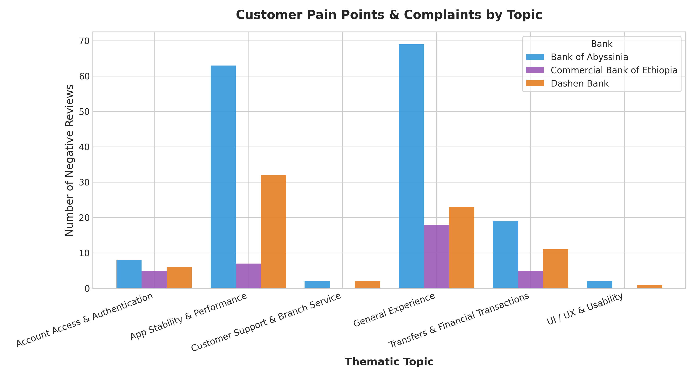

# Customer Experience Analytics for Fintech Apps
### A Real-World Data Engineering, NLP, and Strategic Analytics Pipeline

> **Advisory Firm:** Omega Consultancy  
> **Client Sector:** Ethiopian Commercial Banking (CBE, Bank of Abyssinia, Dashen Bank)  
> **Data Source:** Google Play Store Customer Reviews (1,598 verified unique reviews)  
> **Core Stack:** Python 3.12, Pandas, NLTK VADER, Matplotlib, Seaborn, Regex  

---

## 📌 Executive Summary

Mobile banking in Ethiopia is accelerating at an unprecedented pace. This analytics pipeline transforms raw, unfiltered customer reviews from the Google Play Store into strategic intelligence for executive leadership at **Commercial Bank of Ethiopia (CBE)**, **Bank of Abyssinia (BoA)**, and **Dashen Bank**.

### Executive Benchmark Scorecard

| Bank | Target App Package(s) | Reviews Analyzed | Average Star Rating (1-5) | Average NLP Sentiment (-1 to +1) | Market Standing |
| :--- | :--- | :---: | :---: | :---: | :--- |
| **Commercial Bank of Ethiopia (CBE)** | `prod.cbe.birr` | 375 | **4.16 ⭐** | **+0.259** | 🥇 **Market Leader** |
| **Dashen Bank** | `com.dashen.dashensuperapp` | 425 | **3.62 ⭐** | **+0.212** | 🥈 **UX/Innovation Leader** |
| **Bank of Abyssinia (BoA)** | `com.boa.boaMobileBanking`, `com.boa.apollo` | 798 | **3.36 ⭐** | **+0.129** | 🥉 **High Churn Risk** |

---

## 📊 Visual Analytics & Key Findings

### 1. Executive Performance Benchmark

* CBE dominates customer sentiment (+0.259) and store rating (4.16 ⭐), while Bank of Abyssinia lags due to significant post-update stability issues.

### 2. Sentiment Distribution by Bank

* Over **56.5% of CBE reviews** are positive. Bank of Abyssinia has the largest negative sentiment footprint (18.8%).

### 3. Rating vs. Sentiment Alignment & Discrepancy Detection

* **Alignment Rate: 56.8%**. Star ratings and text sentiment directly agree in the majority of cases.
* **The "Silent Disaster" (36 reviews)**: Users rated 5 stars out of brand loyalty, but typed urgent bug reports regarding app startup crashes. Standard rating tracking completely misses these critical alerts.
* **The "Accidental 1-Star" (103 reviews)**: Users wrote enthusiastic praise but accidentally clicked 1 star, artificially deflating store metrics.

### 4. Thematic Root Causes of Customer Complaints

* **App Stability & Performance accounts for 37.4% of all complaints** (freezing, crashes, white screens).
* **Transfers & Financial Transactions accounts for 12.8%** (failed transfers, debit without credit).
* **UI/UX Usability represents only 1.1% of complaints** -- users love the visual designs, but demand stability and transaction reliability.

---

## 🏛️ Strategic Recommendations for Bank Leadership

### 1. Commercial Bank of Ethiopia (CBE)
* **Key Strength**: Exceptional production stability (lowest crash mentions in market: 9.1%).
* **Actionable Fix**: Introduce in-app biometric credential recovery to eliminate mandatory branch visits for expired passwords, and optimize the SMS gateway to reduce OTP latency during self-registration.

### 2. Bank of Abyssinia (BoA)
* **Critical Risk**: Highest complaint volume in the country; 19.9% of reviews report app freezing or crashes after updates.
* **Actionable Fix**: Halt non-essential feature rollouts and execute a dedicated **Stability Hotfix Sprint**. Implement automated regression testing across entry-level Android devices (Android 8-11).

### 3. Dashen Bank
* **Key Strength**: Highest UI/UX praise across the industry (8.5%).
* **Actionable Fix**: Resolve backend transfer timeout bottlenecks and provide real-time transaction state updates ("Pending at Switch", "Completed") to challenge CBE for the #1 market spot.

---

## 🛠️ Pipeline Architecture & Reproducibility

```
fintech-review-analytics-v2/
├── data/
│   ├── raw/reviews_raw.csv                <- Task 1: 2,000 raw scraped reviews
│   └── processed/
│       ├── reviews_cleaned.csv            <- Task 1: Cleaned & deduplicated reviews
│       ├── reviews_with_sentiment.csv     <- Task 2: VADER scores & alignment tags
│       └── reviews_with_topics.csv        <- Task 3: Thematic banking categories
├── src/
│   ├── scraper.py                         <- Task 1: Google Play Store scraper
│   ├── preprocess.py                      <- Task 1: Data cleaning & normalization
│   ├── sentiment.py                       <- Task 2: Sentiment & alignment engine
│   ├── topics.py                          <- Task 3: Thematic topic classifier
│   └── visualize.py                       <- Task 4: Visualization generator
├── reports/
│   ├── strategic_recommendations.md       <- Full Executive Consulting Report
│   └── figures/                           <- Exported presentation charts (PNG)
└── requirements.txt
```

### Running the End-to-End Pipeline

```bash
# 1. Scrape raw reviews from Google Play Store
python src/scraper.py

# 2. Clean and deduplicate reviews
python src/preprocess.py

# 3. Score VADER sentiment and evaluate rating alignment
python src/sentiment.py

# 4. Classify reviews across the 5 banking themes
python src/topics.py

# 5. Generate executive charts into reports/figures/
python src/visualize.py
```

---

*Full detailed consulting report available in [reports/strategic_recommendations.md](reports/strategic_recommendations.md).*
